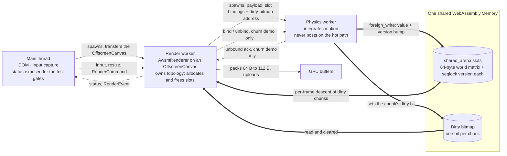

# awsm-renderer — multithreaded reference app

A standalone, copyable example of running the renderer across **real wasm
threads** over a shared `WebAssembly.Memory`. The full end-user guide lives in
**`docs/PLAYER-GUIDE.md` §9**.

## Threading at a glance

Every thread is the *same* wasm module attached to *one* shared
`WebAssembly.Memory`. Main spawns the render worker; in the sim-driven demos
the **render worker** then spawns the physics worker itself and hands it raw
slot addresses once. Solid arrows are spawns, dotted arrows are
`postMessage`, thick arrows are shared-memory reads/writes.



The split is **topology vs values**: only the render worker allocates,
binds and frees slots; a foreign writer only ever stores values into slots
it was handed. A torn value is never accepted — the reader checks the
slot's seqlock version and retries.

What each demo actually runs:

| `?demo=` | Workers (spawned by) | Crosses shared memory | Crosses `postMessage` |
|---|---|---|---|
| `smoke` | A + B (main) | one static `AtomicU32`: A increments, B reads | each worker's observed value, for the gate |
| `arena` | render (main) → physics (render) | a standalone `SharedArena`, hammered by physics, validated by render | bindings once; the verdict to main |
| `render` | render (main) | nothing foreign — the arena is on, but render is its only writer | status |
| `motion` | render (main) → physics (render) | node world matrices | bindings once; status |
| `crowd` | render (main) → physics (render) | two arenas: per-instance matrices (stride 64) + instance attributes (stride 16) | bindings once; status |
| `churn` | render (main) → physics (render) | world matrices of the live bodies | the bind → unbind → unbound transaction; status |
| `lights` | render (main) → physics (render) | the light's bound transform | binding once; status |
| `skin` | render (main) → physics (render) | skin **joint** world matrices | bindings once; status |
| `scene` | render (main) → physics (render) | the runtime light's bound transform | binding once; status |
| `remote` | render (main) | nothing | `RenderCommand` / `RenderEvent`; geometry as transferred `ArrayBuffer`s |
| `input` | render (main) | nothing | `WorkerInputEvent`s main → render; status |

## Run it

```sh
task mt:dev      # trunk serve on http://127.0.0.1:9090 (COOP/COEP enabled)
```

Then open the URL in a browser that supports WebGPU + `SharedArrayBuffer`.

## Demos (`?demo=`)

Each capability is a selectable demo; the default is `input`.

| `?demo=` | What it shows | Source |
|---|---|---|
| `smoke`  | two workers share one `WebAssembly.Memory` (an `AtomicU32` crosses the thread boundary) | `src/smoke.rs` |
| `arena`  | the seqlock arena under a high-rate foreign writer — zero torn values accepted | `src/arena_test.rs` |
| `render` | the full renderer hosted in a worker over the shared **transform arena** (A/B vs `?arena=0`) | `src/render_demo.rs` |
| `motion` | a physics worker moving node transforms via shared memory (`?stress=N`); bounds/culling track the moved positions | `src/motion_demo.rs` |
| `crowd`  | instanced transforms **and** attributes driven by the physics worker (`?stress=N`) | `src/crowd_demo.rs` |
| `churn`  | live spawn/despawn topology as a bind→ack→free transaction (slot reuse, invariant-checked) | `src/churn_demo.rs` |
| `lights` | a physics worker animating a **light** via its bound transform (the lit spot sweeps a static ground) | `src/lights_demo.rs` |
| `skin`   | a physics worker flexing a real rigged glTF (CesiumMan) by driving its **skin joints** through the arena | `src/skin_demo.rs` |
| `scene`  | the **player path** — `load_scene_for_player` runs in the worker, then a runtime light is added + driven by physics through the arena | `src/scene_demo.rs` |
| `remote` | the Layer 1 protocol — DOM driver loads a real **glTF** (DamagedHelmet) over the wire, streams a progress bar, picks, queries bounds, recolours the material | `src/protocol.rs`, `src/remote_demo.rs` |
| `input`  | full input forwarding (pointer/wheel/key/resize) + a main-thread responsiveness meter (Long Tasks API) | `src/input_demo.rs` |

A few demos load real glTF sample assets, bundled **same-origin** by Trunk
(`index.html` `copy-file`) because COEP `require-corp` blocks cross-origin
fetches: `DamagedHelmet.glb` (`remote`), `CesiumMan.glb` (`skin`),
`AnimatedMorphCube.glb`.

The end-user guide for opting a game into this is **`docs/PLAYER-GUIDE.md` §9**.

## The threaded build profile (why it's different)

A normal wasm build has a private, non-shared linear memory — workers can't
share state through it. Three pieces, together, produce a bundle that
imports one **shared** memory all threads attach to:

1. **`rust-toolchain.toml`** pins nightly + `rust-src` (needed for
   `-Z build-std`).
2. **RUSTFLAGS + build-std** (see `taskfiles/examples/multithreaded.yml`):
   - `-C target-feature=+atomics,+bulk-memory,+mutable-globals`
   - `-C link-arg=--shared-memory --import-memory --max-memory=…`
   - `-C link-arg=--export=__heap_base/__tls_base/__tls_size/__tls_align/__wasm_init_tls`
     (wasm-bindgen's thread transform needs these symbols)
   - `-Z build-std=std,panic_abort` (recompiles `std` with atomics)
3. **COOP/COEP headers** on serve (`Trunk.toml`): `Cross-Origin-Opener-Policy:
   same-origin` + `Cross-Origin-Embedder-Policy: require-corp`. Without them
   `crossOriginIsolated` is false and `SharedArrayBuffer` is unavailable.

Each worker attaches to the shared memory via the bootstrap in `src/bootstrap.rs`:
post `{ wasm_module, memory }` to the worker, which calls
`init({ module_or_path: wasm_module, memory })`.

## Status

**Phase 1 (M0–M7) + Phase 2 hardening (H1–H9) complete.** Foundation: cross-origin
isolation + shared-memory smoke; the `shared_arena` seqlock primitive;
arena-backed node transforms with the render-side 64→112 pack; physics-driven
node + instanced transforms/attributes; the Layer 1 remote-renderer protocol;
input forwarding + responsiveness proof. Hardening:

- Native-resolution rendering with live resize + DPR forwarding to the worker.
- Honest responsiveness measured via the Long Tasks API (zero main-thread long
  tasks while the worker loads).
- Sim-moved transforms refresh their world AABB, so frustum culling / shadows /
  picking track the real positions (no stale bounds).
- The arena's value region is `UnsafeCell<u8>` — sound cross-thread writes under
  Stacked Borrows (miri-verified).
- Live spawn/despawn as a bind→ack→free transaction with slot reuse.
- Lights and skinned meshes animate through the transform arena (no new
  foreign-writable buffer): `?demo=lights`, `?demo=skin`.
- Real glTF loaded over the Layer-1 protocol (`?demo=remote`), with the full
  command surface (`LoadGltf`/`UpdateCamera`/`Bounds`/`SetMeshMaterial`/`Pick`;
  `Screenshot` is platform-bounded — see `src/protocol.rs`).
- `queue.writeBuffer`-from-shared-memory settled empirically (it works; the
  per-frame pack is necessary normal-matrix computation, ∝ movers — see
  PLAYER-GUIDE §9.5).

The shared-memory sim-state primitive lives in the renderer crate
(`buffer/shared_arena.rs`); this app is the copyable consumer. The
single-threaded editor / model-viewer builds are untouched and keep using the
stable toolchain — `cargo check --workspace` + the full CI lint stay green.
