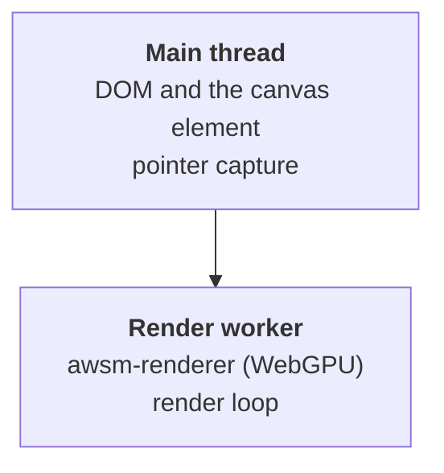
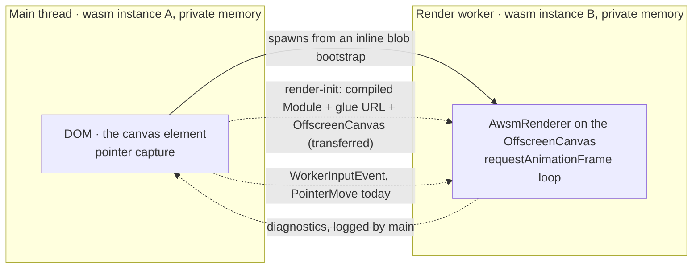

# awsm-renderer — render-worker example

The whole renderer runs in a Web Worker against an `OffscreenCanvas`, on the
ordinary **stable, non-threaded** build. For real wasm threads over shared
memory, see [`examples/multithreaded`](../multithreaded).

## Threading at a glance

### What runs where

### In detail

One worker, and **nothing is shared**: both threads instantiate the same
compiled `WebAssembly.Module`, but each gets its own private linear memory.
There is no `SharedArrayBuffer`, so no COOP/COEP headers and no nightly
toolchain are needed — everything crosses by `postMessage`.

| What | Where it lives | How it crosses |
|---|---|---|
| Compiled wasm module | both threads | structured-cloned once at init, so the worker skips recompiling |
| Linear memory | one private copy per thread | never — nothing is shared |
| The canvas | the worker, after `transferControlToOffscreen()` | transferred once at init |
| Input | captured on main | `WorkerInputEvent` messages (`src/worker.rs`) |

A single wasm bundle serves both roles; `is_worker_scope()` picks the entry
point at runtime. The architecture notes, and what the example deliberately
leaves to the consumer, are in the module docs of `src/lib.rs`.
